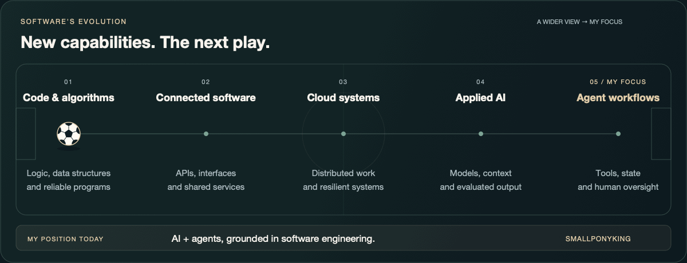
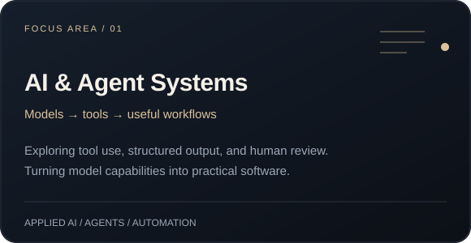
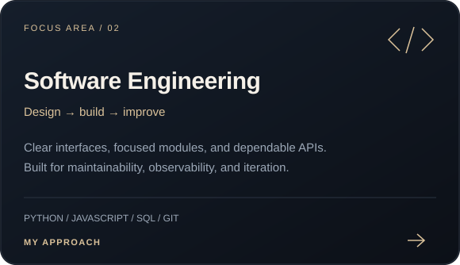

<picture>
  <source media="(prefers-color-scheme: light) and (max-width: 600px)" srcset="./assets/hero-mobile-light.svg" />
  <source media="(prefers-color-scheme: light)" srcset="./assets/hero-light.svg" />
  <source media="(max-width: 600px)" srcset="./assets/hero-mobile.svg" />
  
</picture>

  I build intelligent software with a focus on clear design, dependable systems, and practical AI. 
  Exploring how language models, tools, and thoughtful engineering can work together.

## Software evolution

Code and algorithms. Connected software. Cloud systems. Applied AI. Agent workflows. 
Each layer expands what we can build. Follow the ball to my focus today.

<strong>⚽ Follow the ball</strong> — click to reveal the animation

 

<picture>
  <source media="(prefers-color-scheme: light) and (prefers-reduced-motion: reduce) and (max-width: 600px)" srcset="./assets/evolution-mobile-light-static.png" />
  <source media="(prefers-color-scheme: light) and (prefers-reduced-motion: reduce)" srcset="./assets/evolution-light-static.png" />
  <source media="(prefers-reduced-motion: reduce) and (max-width: 600px)" srcset="./assets/evolution-mobile-static.png" />
  <source media="(prefers-reduced-motion: reduce)" srcset="./assets/evolution-static.png" />
  <source media="(prefers-color-scheme: light) and (max-width: 600px)" srcset="./assets/evolution-mobile-light.gif" />
  <source media="(prefers-color-scheme: light)" srcset="./assets/evolution-light.gif" />
  <source media="(max-width: 600px)" srcset="./assets/evolution-mobile.gif" />
  
</picture>

### Where I am now

My focus is **AI and agent systems, grounded in software engineering**: connecting models with tools, keeping state useful, and making results clear enough for people to review. I care about the foundations behind the intelligence—reliable code, thoughtful design, and room to keep improving.

## Focus areas

<table>
  <tr>
    <td width="50%" valign="top">
<picture>
  <source media="(prefers-color-scheme: light) and (max-width: 600px)" srcset="./assets/ai-systems-mobile-light.svg" />
  <source media="(prefers-color-scheme: light)" srcset="./assets/ai-systems-light.svg" />
  <source media="(max-width: 600px)" srcset="./assets/ai-systems-mobile.svg" />
  
</picture>
    </td>
    <td width="50%" valign="top">
<picture>
  <source media="(prefers-color-scheme: light) and (max-width: 600px)" srcset="./assets/engineering-mobile-light.svg" />
  <source media="(prefers-color-scheme: light)" srcset="./assets/engineering-light.svg" />
  <source media="(max-width: 600px)" srcset="./assets/engineering-mobile.svg" />
  
</picture>
    </td>
  </tr>
</table>

## Engineering approach

| Focus | What it means in my work |
| :--- | :--- |
| **Applied AI** | Structured model output, explicit validation, and practical fallbacks. |
| **Agent workflows** | Tool use, persistent state, clear boundaries, and human review. |
| **Reliable execution** | Resumable queues, bounded concurrency, retries, and visible failures. |
| **Maintainable software** | Focused modules, automated tests, and straightforward interfaces. |

**Working toolkit** &nbsp; Python · JavaScript · SQL · HTML/CSS · Git

<strong>Inside the work: what I'm exploring</strong>

 

- Agents that can use tools while leaving a clear record of their decisions.
- Workflows that combine deterministic rules with model assistance.
- Better ways to evaluate model output and handle uncertain results.
- Interfaces that make complex background work easy to understand.

---

Read the field. Build the play. Keep improving.

