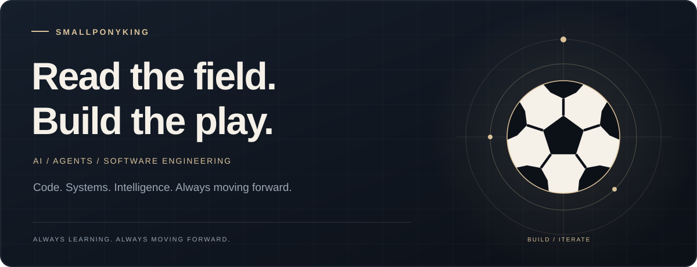
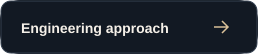
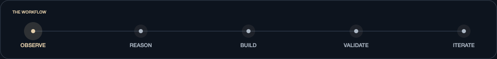
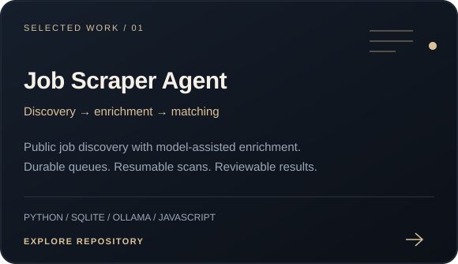
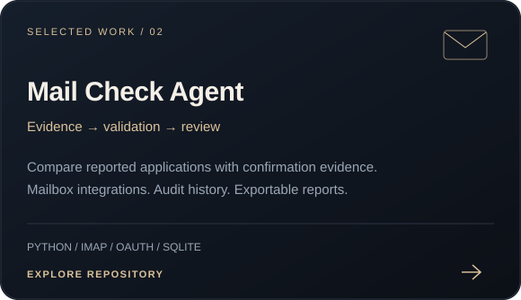

  <picture>
    <source media="(max-width: 600px)" srcset="./assets/hero-mobile.svg" />
    
  </picture>

  
  
  

  I build software that turns repetitive research and review into practical workflows. 
  My focus: useful AI, agents with inspectable results, and systems that recover when work gets interrupted.

<picture>
  <source media="(prefers-reduced-motion: reduce)" srcset="./assets/workflow.svg" />
  
</picture>

## Selected work

<table>
  <tr>
    <td width="50%" valign="top">
      <a href="https://github.com/SmallPonyKing/Job-Scraper-Agent"><picture><source media="(max-width: 600px)" srcset="./assets/job-scraper-mobile.svg" /></picture></a>
    </td>
    <td width="50%" valign="top">
      <a href="https://github.com/SmallPonyKing/Mail-check-agent"><picture><source media="(max-width: 600px)" srcset="./assets/mail-check-mobile.svg" /></picture></a>
    </td>
  </tr>
  <tr>
    <td><a href="https://github.com/SmallPonyKing/Job-Scraper-Agent#readme">Read the architecture &amp; setup ↗</a></td>
    <td><a href="https://github.com/SmallPonyKing/Mail-check-agent#readme">Explore the audit workflow ↗</a></td>
  </tr>
</table>

## Engineering approach

| Focus | What it means in my work |
| :--- | :--- |
| **Applied AI** | Structured model output, explicit validation, and practical fallbacks. |
| **Agent workflows** | Tool use, persistent state, clear boundaries, and human review. |
| **Reliable execution** | Resumable queues, bounded concurrency, retries, and visible failures. |
| **Maintainable software** | Focused modules, automated tests, and straightforward interfaces. |

**Working toolkit** &nbsp; Python · SQLite · Ollama · JavaScript · HTML/CSS · Git

<strong>Inside the work: what I'm exploring</strong>

 

- Agents that can use tools while leaving a clear record of their decisions.
- Workflows that combine deterministic rules with model assistance.
- Better ways to evaluate model output and handle uncertain results.
- Interfaces that make complex background work easy to understand.

---

  <strong>Have a workflow worth improving?</strong> 
  <a href="https://github.com/SmallPonyKing/SmallPonyKing/issues/new">Start a conversation</a>
  &nbsp; · &nbsp;
  <a href="https://github.com/SmallPonyKing?tab=repositories">Explore all repositories</a>

Thoughtful systems. Practical outcomes.

