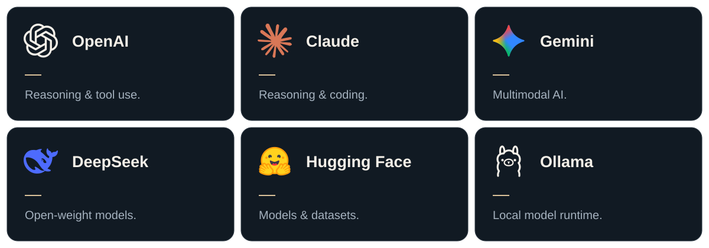

<picture>
  <source media="(prefers-color-scheme: light) and (max-width: 600px)" srcset="./assets/hero-mobile-light.svg" />
  <source media="(prefers-color-scheme: light)" srcset="./assets/hero-light.svg" />
  <source media="(max-width: 600px)" srcset="./assets/hero-mobile.svg" />
  
</picture>

<strong>AI · Agents · Software Engineering</strong> 
Building useful intelligence with reliable software.

## AI landscape

<picture>
  <source media="(prefers-color-scheme: light) and (max-width: 600px)" srcset="./assets/ai-landscape-mobile-light.svg" />
  <source media="(prefers-color-scheme: light)" srcset="./assets/ai-landscape-light.svg" />
  <source media="(max-width: 600px)" srcset="./assets/ai-landscape-mobile.svg" />
  
</picture>

<strong>My direction</strong> 
Models + tools + human review → dependable agents.

<strong>⚽ Follow the ball</strong> — software evolution → my focus

 

<picture>
  <source media="(prefers-color-scheme: light) and (prefers-reduced-motion: reduce) and (max-width: 600px)" srcset="./assets/evolution-mobile-light-static.png" />
  <source media="(prefers-color-scheme: light) and (prefers-reduced-motion: reduce)" srcset="./assets/evolution-light-static.png" />
  <source media="(prefers-reduced-motion: reduce) and (max-width: 600px)" srcset="./assets/evolution-mobile-static.png" />
  <source media="(prefers-reduced-motion: reduce)" srcset="./assets/evolution-static.png" />
  <source media="(prefers-color-scheme: light) and (max-width: 600px)" srcset="./assets/evolution-mobile-light.gif" />
  <source media="(prefers-color-scheme: light)" srcset="./assets/evolution-light.gif" />
  <source media="(max-width: 600px)" srcset="./assets/evolution-mobile.gif" />
  
</picture>

Read the field. Build the play. Keep improving.

